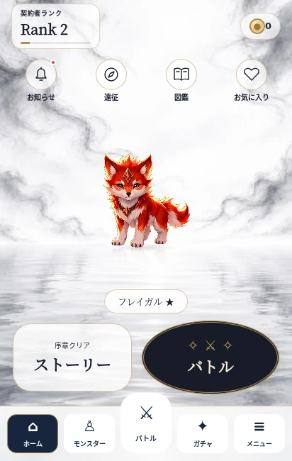
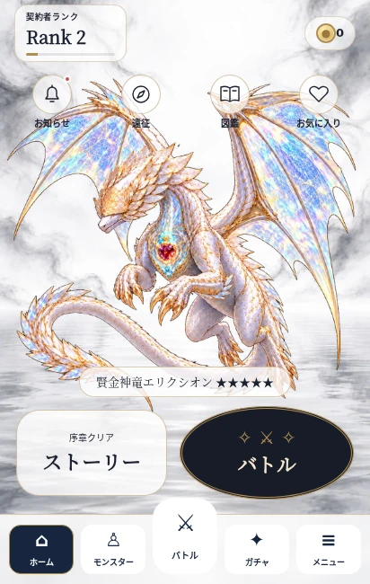
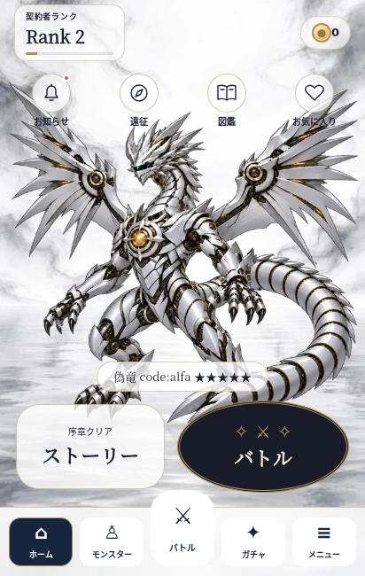
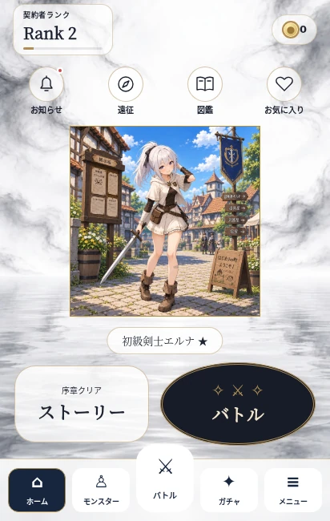

# 採用ホーム画面の実装・確認記録（2026-11-01）

対象: `kankidoi2-byte/monster-rpg-ver8`、作業ブランチ `feat/home-water-20261101`。
開始点: main `9bf5ac4641da809ad0ec17c120e93296d922bd57`。
仕様: [ホーム画面 改修仕様書(採用案)｜ChatGPT向け実装依頼](https://docs.google.com/document/d/1cDXOwX80VgZnfPU_ptEwgrww66kHt07DOaynGkCb_-U/edit)。0章の参照先は7章として読んだ。
マージ・公開先更新は所有者の明示許可待ち。

## 実装前の導線確認とキャラクター案

- 通常編成: 下部「モンスター」→「パーティーを編成する」→既存 `partySet`。ホームの編成・パーティープレビューを除去しても到達可能。
- 序章: `home_party` と `expedition_party_open` は旧 `#homePartyEditButton` を直接案内していた。IDを下部「モンスター」に移し、この2手順中だけ既存編成画面へ直接進む。ストーリー本文・保存ステップIDは変更しない。
- 遠征: 上部ショートカット→既存 `showExpedition()`。案内が使う `#homeExpeditionPreview button` をショートカットの実ボタンに保持する。
- お知らせ: 上部ショートカット→既存 `showNotices()`。未読表示・既読保存を維持。旧プレビュー表示は除去。
- キャラクター案: ①既存の額縁を残す暫定案、②白・金の肖像カード、③透過立ち絵を制作して水面に配置。今回は仕様6章に従い①の既存表示を維持。②③の新しい見た目は未採用・未実装。

## 仕様との差分とユーザー確認

Driveの指定フォルダの一覧には仕様書だけが返されたため、ユーザー指定の添付水面PNGを使用した。新規 `images/maps/home_water_mirror_v1.webp` は864×1536、54,712 bytes（約53.4 KiB、700 KiB未満）。

5章のスライム下端は現行素材と座標が一致しなかった。現行コードはスライム563、ゴールドスライム559で、仕様書の188／186とは異なる。実装前に報告し、ユーザーから「実測値に合わせる」の回答を得た。

FFmpegのlibvpx-vp9でアルファを復号し、各240コマのalpha > 0の範囲を合成した（右・下端はexclusive）。

| ID | 現行動画の解像度 | 全コマの合成範囲 x/y/right/bottom | 今回の下端変更 | scale |
|---|---|---|---|---|
| slime | 720×640 | 37 / 37 / 675 / 572 | 563 → 572 | 0.3を維持 |
| slime_gold | 720×640 | 38 / 62 / 667 / 562 | 559 → 562 | 0.5 → 0.3 |

他の境界座標・動画・ポスターは変更していない。ホームは独自倍率表を持たず、`BATTLE_IDLE_MEDIA` の `layout.scale` と `sourceBounds` から7章の式で計算する。矩形動画には `sourceBounds.height` を用い、縦横比と反射の足元を保つ。

## ブラウザー確認

Chromiumのタッチ端末エミュレーション。実機Galaxy・実機Safariではない。

- 412×650 / 390×844 / 360×600 / 横向き844×390で、50体ずつ配置とクリックを確認。
- 各サイズでscale≤0.75の42体が上部アイコン・名前札の計算領域内に収まる。大型8体ははみ出しても各ショートカット・アクションをクリック可能。
- 大型キャンバスによるモバイル表示領域の拡張を防止。横向きの低い画面は操作欄を詰め、同じ体格計算式で再配置する。
- 透過動画再生・タップ反応、画面離脱時の再生解放を確認。
- お気に入り選択→保存→再読込で同じIDと表示が復元される。
- 契約者ランク／お知らせ・既読／遠征／図鑑、モンスター→編成→保存を確認。
- ホーム→バトル→草原→Easy→戦闘開始まで確認。
- 動きを減らす設定、非対応コーデック、読込／再生エラーで同位置のポスターへ切り替わることを確認。WebKitは透過ポスターを優先する。
- 合成セーブのみ使用。プレイヤーのセーブやアカウントは使用していない。

自動検査の詳しい結果は `browser-report.json`。実行例:

```sh
npm run check
node scripts/test-home-water-browser.mjs
```

ブラウザーはPlaywrightを別途用意する。任意のChromiumを使用する環境では `PLAYWRIGHT_CHROMIUM_EXECUTABLE_PATH` を指定できる。

## Galaxyで所有者が確認する点

1. フレイガル・スライム・ゴールドスライム・★3で、体の大きさとアイコン／名前札との距離を確認。スライム2体は長辺の大きさが同じ。
2. 偽竜・エリクシオン・キメラグナ・アペクスを表示し、頭や翼がUIの後ろに入る見た目と、全ボタンの押しやすさを確認。
3. 動画・足元の影・水面反射・タップ時の跳ね方を確認。
4. エルナ等のキャラクターは既存の額縁表示でよいか確認。キャラクターの新デザインは未決。
5. お気に入り変更・再起動後の保持、未読点の消灯、遠征・図鑑・編成・ストーリー・バトルへの導線を確認。
6. 画面回転とアドレスバーの出入り、端末の文字サイズ変更、バックグラウンド復帰でレイアウトや動画に問題がないか確認。

## 画像

| フレイガル | 大型種・エリクシオン |
|---|---|
|  |  |

| 偽竜 | キャラクター・既存の額縁 |
|---|---|
|  |  |

## 変更ファイル

| ファイル | 変更内容 |
|---|---|
| `index.html` | ホームの構成、上部ランクEXPバー、下部ナビの案内ID、読込参照 |
| `css/home-water.css` | 水面・UI・影と反射・大型種のクリップ・低い画面の配置 |
| `js/home-water.js` | 体格の共通データからの配置、モーションとポスター、表示の破棄・再開、編成導線 |
| `js/ui.js` | 新ホームの描画と画面移動時の連携、旧プレビュー描画の除去 |
| `js/battle-idle-media.js` | ゴールドスライムの倍率、2体の下端、サイズ方針コメント |
| `js/notices.js` | プレビューを上書きせずショートカットの未読表示を更新 |
| `js/notices-data.js` | プレイヤー向けのお知らせ追加 |
| `images/maps/home_water_mirror_v1.webp` | 採用の水面背景 |
| `package.json` | 配置検査を `npm run check` に追加 |
| `scripts/test-battle-idle-media-dom.mjs` | CI専用のサイズ検査を採用仕様のゴールドスライム倍率0.3へ更新 |
| `scripts/test-home-water.mjs` | 50体の配置式、サイズ、境界、導線と容量の検査 |
| `scripts/test-home-water-browser.mjs` | 実ブラウザーの配置・押下・保存・再読込・ポスター検査 |
| `scripts/test-audit-profile-expedition-browser.mjs` | 新しい編成経路、Chromium実行パス指定への対応 |
| `scripts/test-battle-journey-dom.mjs` / `scripts/test-map-story-dom.mjs` / `scripts/test-map-story-browser.mjs` | 編成経路の変更に合わせた期待値・操作の更新 |
| `docs/home-water-20261101/README.md` / `browser-report.json` / `freigal.webp` / `elixion.webp` / `false_dragon_alfa.webp` / `elna_beginner.webp` | 仕様差分・検査記録・Galaxy確認事項・比較画像 |

## 最終検査結果

- `npm run check`: **PASS（終了コード0）**。`check:battle-motion`、画像容量、保存互換、序章・遠征のブラウザー検査を含む全体検査。
- `node scripts/test-home-water-browser.mjs`: **PASS（終了コード0）**。50体×4画面サイズ、42体の領域内表示、大型種のクリック、動画・ポスター、保存・再読込、実際の戦闘開始。ブラウザーの未処理エラー0件。
- `node scripts/test-map-story-browser.mjs`: **PASS（終了コード0）**。ホームから編成・ストーリーへの導線、モバイル・横向き・200%表示、草原全11話、実際の戦闘・再読込。
- `git diff --check`: **PASS**。
- 検査環境: Node.js 24.22.1 / Chromium 153のヘッドレス実行。実機Galaxy・Safariの確認は未実施。
- 既存セーブキー・お気に入り保存処理・ストーリー本文・公開先は変更していない。本編へのマージ・公開は未実施。

追加確認: CI専用DOM検査に旧ゴールドスライム倍率0.5の期待値が残っていたため、採用仕様の0.3へ更新した。ゲーム本体の追加変更はない。CIと同じ16個のDOM検査に `test-map-story-dom.mjs` を加えた計17個をローカルで実行し、すべてPASS（終了コード0）。本体・全体検査の入力を変更していないため、成功済みの `npm run check` は再利用した。
